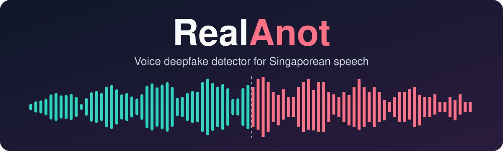
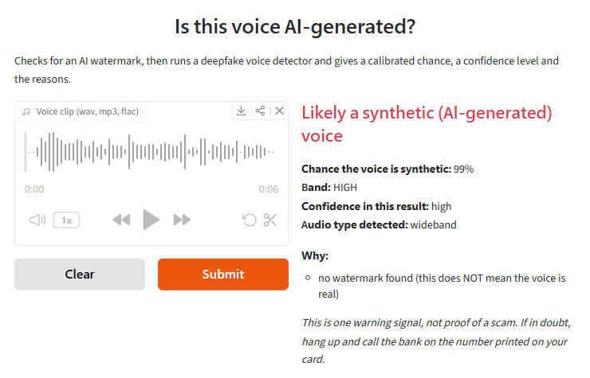

<p align="center">
  
</p>

<p align="center">
  
  
  
</p>

<p align="center">
  <a href="#results-so-far">Results</a> ·
  <a href="#how-it-works">How it works</a> ·
  <a href="#known-problems">Known problems</a> ·
  <a href="#roadmap">Roadmap</a> ·
  <a href="#running-it">Running it</a>
</p>

RealAnot checks a voice clip and estimates how likely it is that the voice was generated by AI. The name comes from the Singlish "real anot?", meaning "real or not?".

Most of the work went into Singaporean voices and low-quality audio. The first version rated more than half of real Singlish conversation clips as likely AI, and phone audio roughly doubled its error rate.

**This is version 1 and it isn't finished.** It works on attached voice clips, and live phone calls come next. The numbers below will change as training and testing continue.

The base model is [forensics XLS-R + AASIST](https://huggingface.co/eliya/forensics_0.3B_xlsr_wild_deepfake_classifier).

## Results so far

These are test clips that were not used to train the model or choose it. RealAnot here means the original model and the retrained head combined, which is what the verdict uses. EER (equal error rate) is the error rate where missed fakes and wrongly flagged real voices are equal, and lower is better. It picks the best cut-off for the data being measured, so it runs optimistic. The last two columns use the fixed 50% cut-off, which was set on separate clips.

| Test set | Audio | Original EER | RealAnot EER | Fakes missed | Real voices flagged |
|---|---|---:|---:|---:|---:|
| Singapore (798 clips) | Clean | 7.92% | 0.00% | 0.2% | 0.0% |
| Singapore | Compressed | 7.75% | 0.00% | 0.8% | 0.0% |
| Singapore | Phone | 11.56% | 3.01% | 2.6% | 3.3% |
| LibriSpeech (400 clips) | Clean | 7.50% | 0.00% | 0.5% | 0.0% |
| LibriSpeech | Compressed | 6.00% | 1.25% | 2.0% | 0.5% |
| LibriSpeech | Phone | 16.25% | 5.50% | 2.0% | 13.0% |

<details>
<summary><b>Phone audio by type of fake</b></summary>

<br>

Orpheus and Piper were used in training, with different voices from these. SpeechT5 was never used in training.

| Test set | Fakes | Original EER | RealAnot EER |
|---|---|---:|---:|
| Singapore | Orpheus | 7.02% | 3.51% |
| Singapore | Piper | 26.67% | 3.17% |
| Singapore | SpeechT5 | 8.00% | 1.67% |
| LibriSpeech | Piper | 25.25% | 6.75% |
| LibriSpeech | SpeechT5 | 8.00% | 2.75% |

</details>

**Real deepfakes.** These are 6 public deepfake clips of Singapore officials, which were never trained on. Six clips show how it behaves, but they're too few for an accuracy figure.

| Verdict | As received | After a simulated GSM call |
|---|---:|---:|
| HIGH | 3 | 4 |
| MEDIUM | 0 | 1 |
| LOW | 0 | 1 |
| INCONCLUSIVE | 3 | 0 |

Run-by-run notes are in [docs/eval_results.md](docs/eval_results.md).

## How it works

1. Check for an AudioSeal watermark. If there is one, the clip is flagged as AI-generated and the check stops.
2. Work out whether the clip is normal audio or phone audio.
3. Score the clip in overlapping 5 second windows.
4. Convert the score into a percentage chance that the voice is synthetic, calibrated separately for each audio type.
5. Return LOW, MEDIUM or HIGH with a confidence level and the reasons.

Clips that are too short, or whose windows disagree, come back as INCONCLUSIVE. The result is one signal to weigh up. It can't prove that a call is a scam.

Here is the real output for two test clips, one real Singaporean speaker and one Orpheus fake:

```text
real_singaporean_voice.wav
  Probably a real human voice
  Chance it is synthetic: 1%   band: LOW   confidence: high   audio: wideband
   - no watermark found (this does NOT mean the voice is real)

ai_singlish_voice.wav
  Likely a synthetic (AI-generated) voice
  Chance it is synthetic: 99%   band: HIGH   confidence: high   audio: wideband
   - no watermark found (this does NOT mean the voice is real)
```

The same fake clip on the local demo page:

<p align="center">
  
</p>

## Project structure

```text
realanot/
├── app/         local demo page
├── audio/       phone line and clip compression simulation
├── data_prep/   builds the training and test data
├── detectors/   model wrapper, watermark check, calibration, verdict
├── docs/        research notes and run-by-run results
├── eval/        evaluation scripts
├── tests/       unit tests
└── train/       fine-tuning, which retrains only the small head
```

Only the 487,655-parameter head gets retrained and the backbone stays frozen, so training fits on a 6 GB laptop GPU.

## Known problems

- Real deepfakes are much harder than test clips. The most recent attack in the set, footage of a 2026 deepfake Zoom call, was missed: 5% chance as received and 14% after a simulated call. That clip also has captions and music in it.
- Mixed clips, such as news reports that include a deepfake, tend to come back INCONCLUSIVE. Three of the 6 did as received.
- Results vary by voice. On the one Orpheus voice held back for choosing the model, the retrained head alone had a 16.12% phone EER, far worse than the test voices.
- False alarms on phone audio depend on the speakers: 3.3% of real Singaporean voices were flagged, but 13.0% of LibriSpeech voices.
- The fakes in the test clips come from open-source text-to-speech, not the commercial cloning tools scammers may use.
- AudioSeal watermarks were detected every time on clean audio, but never through AMR-NB or Opus.
- The phone line is simulated. Nothing has been tested on real calls yet.

## Roadmap

- [x] Watermark check, detector and calibrated verdict
- [x] Phone line and clip compression simulation
- [x] Singaporean speech and Singlish fakes in training
- [x] Test the current version on all clip sets
- [ ] Train on vocoded fakes, where real clips are rebuilt by neural vocoders so the model can't rely on the speaker or accent
- [ ] Final calibration and final test
- [ ] Live phone calls

## Running it

```bash
python -m detectors.verdict path/to/clip.wav    # check a clip
python -m app.demo                              # local page at http://127.0.0.1:7860
python -m audio.phone in.wav out.wav --seed 0 --codec gsm    # make a clip sound like a call
python -m pytest tests                          # run the tests
```

<details>
<summary><b>Setup (Windows)</b></summary>

Run everything from the repo root.

```bash
py -3.13 -m venv .venv
.venv\Scripts\activate
pip install torch==2.11.0 torchaudio==2.11.0 --index-url https://download.pytorch.org/whl/cu128
pip install -r requirements.txt
```

Without an NVIDIA GPU, use `/whl/cpu` in place of `/whl/cu128`.

The retrained head is included at `detectors/realanot_head.safetensors`, but the base model is too large for this repo. Download it first (about 1.2 GB):

```bash
python -c "from huggingface_hub import snapshot_download; snapshot_download('eliya/forensics_0.3B_xlsr_wild_deepfake_classifier', local_dir='models/forensics_xlsr', ignore_patterns=['*.pt'])"
```

The watermark check needs two small files (about 94 MB):

```bash
python -c "from huggingface_hub import hf_hub_download as d; [d('facebook/audioseal', f, local_dir='downloads/audioseal') for f in ('detector_base.pth', 'generator_base.pth')]"
```

The scripts in `data_prep/`, `train/` and `eval/` rebuild the datasets, retrain the head and repeat the tests. Each one explains its use at the top of the file.

</details>

## Data

The only model weights stored here are the small retrained head. Datasets, audio and results aren't included. Nobody's voice was cloned: the fakes use the stock voices of open-source text-to-speech tools. The deepfake clips of officials were used for testing only, were never trained on, and aren't shared here.

## Credits

The base detector is licensed CC-BY-NC-4.0, and some of the training voices are non-commercial too, so the retrained head is for non-commercial use only as well. Every model, dataset and library is listed in [CITATIONS.md](CITATIONS.md).
